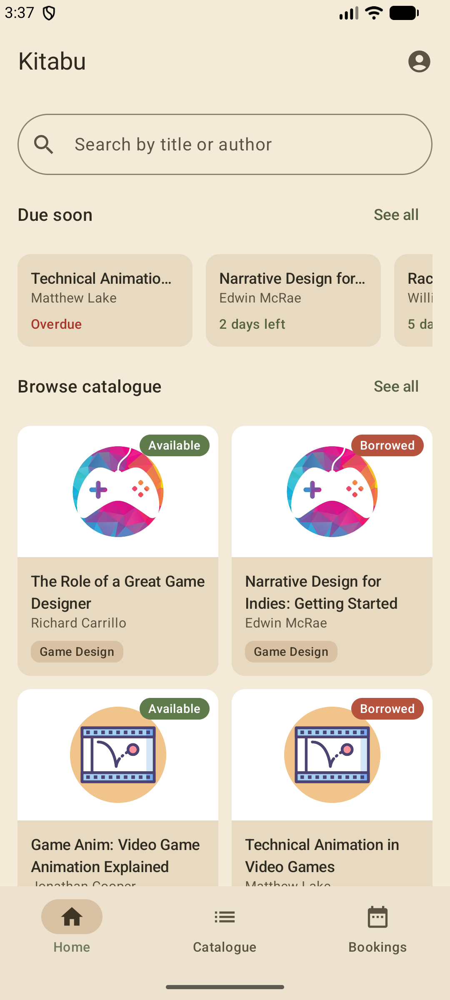
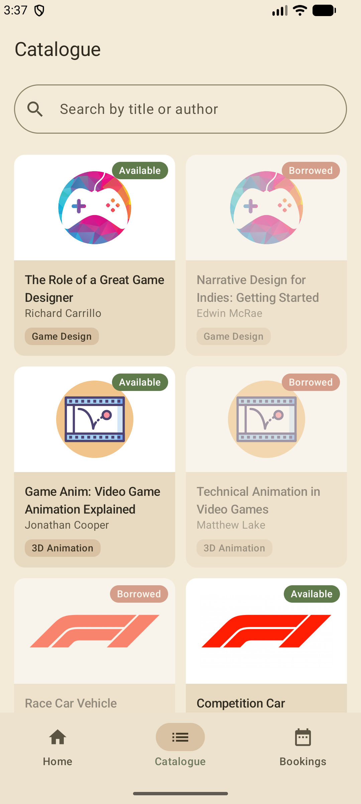
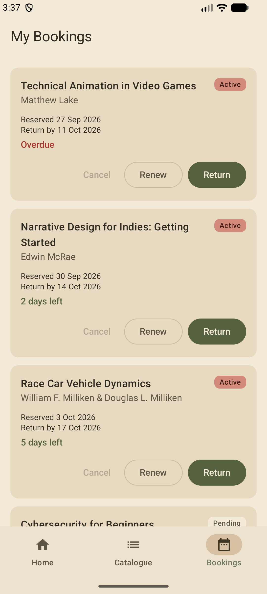

# Kitabu

Kitabu is an Android library app for browsing a small book catalogue, reserving books, and managing your loans. It is built with Kotlin and Jetpack Compose and stores everything locally on the device with a Room database, so it works fully offline.

*Kitabu* means "book" in Swahili.

## Screenshots

<table>
  <tr>
    <th>Home</th>
    <th>Catalogue</th>
    <th>My Bookings</th>
  </tr>
  <tr>
    <td></td>
    <td></td>
    <td></td>
  </tr>
</table>

## Features

- **Home**: a "Due soon" row showing your active loans and how many days are left on each (or "Overdue"), plus a preview of the catalogue. Search on this screen filters both sections.
- **Catalogue**: a responsive grid of books with category icons, category tags and an availability badge. Search by title or author.
- **Reserve a book**: tap an available book to open a bottom sheet, pick a rental period of **7, 14 or 21 days**, and reserve it.
- **My Bookings**: every current booking with its reserved date, return-by date and days remaining.
  - **Pending** bookings can be marked **Collected** or **Cancelled**.
  - **Active** bookings can be **Renewed** (adds 7 days) or **Returned**.
  - Returning or cancelling asks for confirmation first, and the book becomes available again.
- Snackbar feedback after every action (e.g. "Reserved … for 14 days").
- A custom "Cottage Core" colour theme (cream, sage, olive and rose).

## Booking lifecycle

```
 Book available
      │
      │ Reserve (7, 14 or 21 days)
      ▼
   PENDING ── Cancel ──► booking deleted, book available again
      │
      │ Collected
      ▼
   ACTIVE ◄── Renew (+7 days)
      │
      │ Return
      ▼
   RETURNED ──► book available again
```

A book can only have one open booking at a time. Reserving, returning and cancelling run inside Room transactions so a book's availability and its booking always stay in sync.

## Sample data

On first launch the database is seeded with 10 books across five categories (Game Design, 3D Animation, Motorsport Engineering, Cyber Security and Software Engineering) and four example bookings, including one that is overdue and one that is still pending, so every screen has something to show straight away.

There is no login; all bookings are made under the default user "Student".

## Tech stack

| Area | Library |
|---|---|
| Language | Kotlin |
| UI | Jetpack Compose, Material 3 |
| Navigation | Navigation Compose (bottom navigation bar) |
| State | ViewModel, `StateFlow`, Kotlin Coroutines & Flow |
| Storage | Room (with KSP) |
| Testing | JUnit 4, AndroidX Test (instrumented Room tests) |

**SDK levels:** min SDK 24 (Android 7.0), target and compile SDK 37.

## Architecture

The app follows a simple layered (MVVM + repository) structure with manual dependency injection:

```
UI (Compose screens)  →  ViewModels  →  LibraryRepository  →  Room DAOs  →  SQLite
```

- **`AppContainer`** creates the database and repository once, lazily, and `KitabuApplication` holds it for the whole app.
- **`AppViewModelProvider`** builds each ViewModel with the shared repository.
- **`LibraryRepository`** converts database entities into domain models, validates rental lengths, and escapes `%` and `_` in search text so they are matched literally.
- **Domain** code (`Models.kt`, `Validation.kt`) contains plain Kotlin rules with no Android dependencies, such as the allowed rental periods, the 50‑character search limit and overdue / days‑remaining calculations.

## Project structure

```
app/src/main/java/com/example/kitabusf1/
├── data/
│   ├── local/          # Room: AppDatabase, entities, DAOs, type converters, seed data
│   └── repository/     # LibraryRepository
├── di/                 # KitabuApplication, AppContainer, AppViewModelProvider
├── domain/             # Book, Booking, BookingStatus, validation rules
└── ui/
    ├── Home.kt, Catalogue.kt, Bookings.kt      # Screens
    ├── *ViewModel.kt                           # Screen state and actions
    ├── Navigation.kt, KitabuApp.kt             # Bottom bar and NavHost
    ├── Components.kt                           # Shared cards, badges, search field
    └── theme/                                  # Cottage Core colours, typography
```

## Getting started

### Requirements

- A recent version of [Android Studio](https://developer.android.com/studio) that supports Android Gradle Plugin 9.3 and SDK 37
- An emulator or physical device running Android 7.0 (API 24) or newer

### Run the app

1. Clone the repository:
   ```bash
   git clone https://github.com/KRaletsemo/Kitabu_MADB372_SF1.git
   ```
2. Open the project folder in Android Studio and let Gradle sync.
3. Select a device or emulator and press **Run**.

Or build a debug APK from the command line:

```bash
./gradlew assembleDebug
```

## Running the tests

The database and repository tests are instrumented tests that use an in-memory Room database, so they need a connected device or emulator:

```bash
./gradlew connectedAndroidTest
```

They cover:

- Search by title or author, ignoring case and surrounding spaces
- `%` and `_` being treated as normal characters in search
- Reserving a book makes it unavailable and creates a pending booking
- A book cannot be reserved twice
- The full collect → renew → return flow
- Cancelling a pending booking frees the book; active bookings cannot be cancelled
- Only 7, 14 or 21 day rentals are accepted
- Current bookings are sorted by return deadline
- Seed data is inserted correctly

## Author

Katlego Raletsemo ([@KRaletsemo](https://github.com/KRaletsemo))
